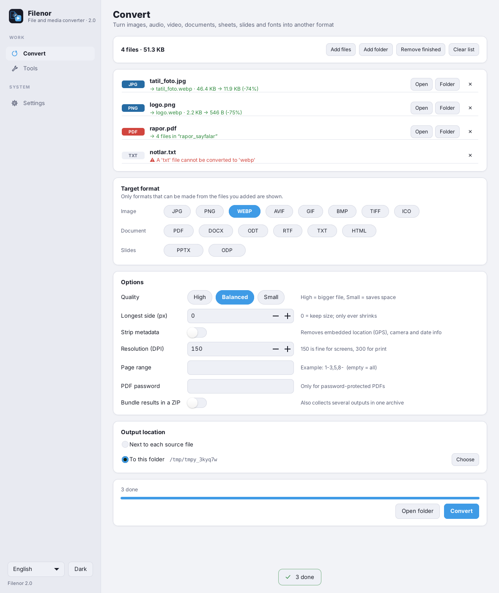
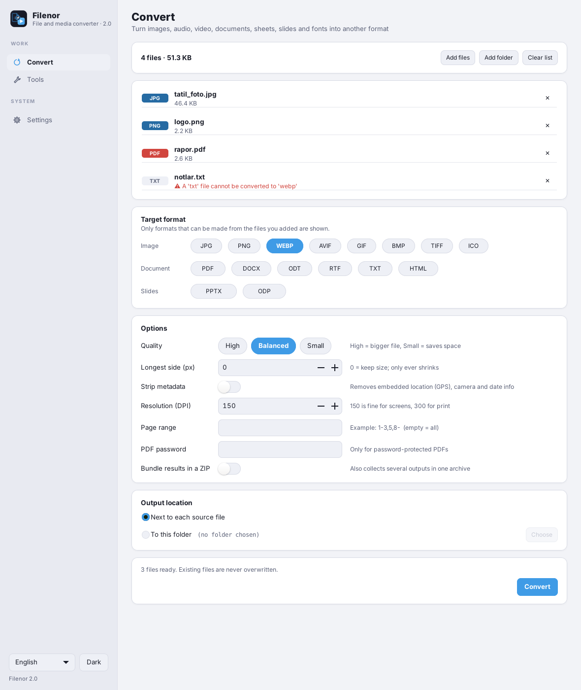
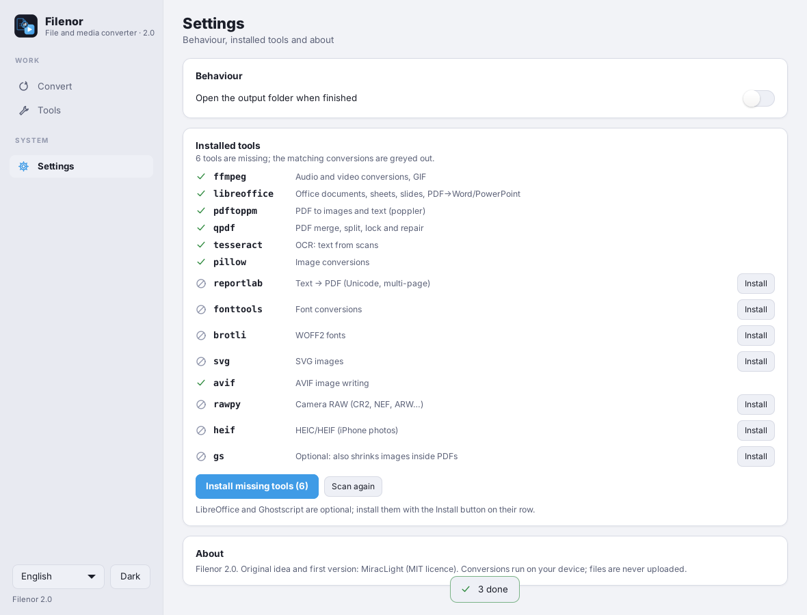

# Filenor

[Türkçe](README.tr.md) · English


**A private file and media converter.** Everything runs on your own computer. Nothing is uploaded, no account is needed, no internet connection is required to convert.



## Features

- **Convert** images (JPG, PNG, WEBP, AVIF, GIF, BMP, TIFF, ICO, HEIC, camera RAW, SVG), audio, video, GIF, PDF ↔ images/text, Office documents, sheets and slides (through LibreOffice) and fonts (TTF/OTF/WOFF/WOFF2).
- **PDF and image tools:** merge, split, pick pages, rotate, shrink, lock/unlock PDFs, OCR, shrink images and strip metadata, trim audio/video.
- **Safe by design:** every conversion goes through a hidden work folder and never overwrites an existing file (`name (1).ext`). External programs run in their own process group and stop on cancel or timeout.
- **Batch queue** with drag & drop, per-file progress and cancel.
- **One-click tool install:** missing helpers (ffmpeg, LibreOffice, poppler, qpdf, Tesseract …) are installed from *Settings → Install* — with `apt` on Debian/Ubuntu and `winget` on Windows. Formats whose tool is missing are greyed out instead of failing.
- **Command line:** `filenor-cli` uses the same engine.
- Dark and light theme, Turkish and English.

<p>


</p>

## Install

Download from the [Releases](https://github.com/MiracLight/filenor/releases) page.

### Debian / Ubuntu

```bash
sudo apt install ./filenor_*_all.deb
filenor
```

Needs Debian 12+ or Ubuntu 24.04+ (Python 3.11+, GTK 3). Dependencies are pulled in by `apt`.

### Windows

Run `Filenor-<version>-setup.exe` (per-user, no administrator rights needed) or unzip `Filenor-<version>-windows-x64.zip` and start `Filenor.exe`.

Helper programs such as ffmpeg and LibreOffice are **not bundled** (their licences differ from Filenor's). Open *Settings* and press **Install missing tools**; Filenor installs them with `winget` (Windows 10 1809+ / 11).

### From source

```bash
sudo apt install python3-gi gir1.2-gtk-3.0 python3-pil     # Debian/Ubuntu
python3 filenor/filenor_uygulama.py
```

## Command line

```text
filenor-cli durum                       installed tools
filenor-cli kur [TOOL...]               install missing tools (--deneme: only show the plan)
filenor-cli formatlar [ext]             which format can become which
filenor-cli donustur -t TARGET FILE...  convert, e.g.  filenor-cli donustur -t webp photo.jpg
filenor-cli arac TOOL FILE...           run a tool, e.g.  filenor-cli arac pdf_birlestir a.pdf b.pdf
```

Exit codes: `0` all done, `1` at least one failed, `2` usage, `130` cancelled. Use the `FILENOR_PAROLA` environment variable for PDF passwords (arguments are visible in `ps`).

## Build

```bash
packaging/debian/build-deb.sh 2.0.0 dist     # .deb
```

Windows packages are built by GitHub Actions (MSYS2 + PyInstaller + Inno Setup); see `.github/workflows/build.yml` and `packaging/windows/`.

Tests: `python3 -m unittest discover -s tests` (UI tests need GTK and a display, e.g. `xvfb-run`).

## History

Version 1 was a single-file customtkinter script for Windows; it is kept as `legacy/Filenor_v1.py`. Version 2 is a rewrite on GTK 3 with a shared engine for Linux and Windows. See [CHANGELOG.md](CHANGELOG.md).

## License

MIT — see [LICENSE](LICENSE).
