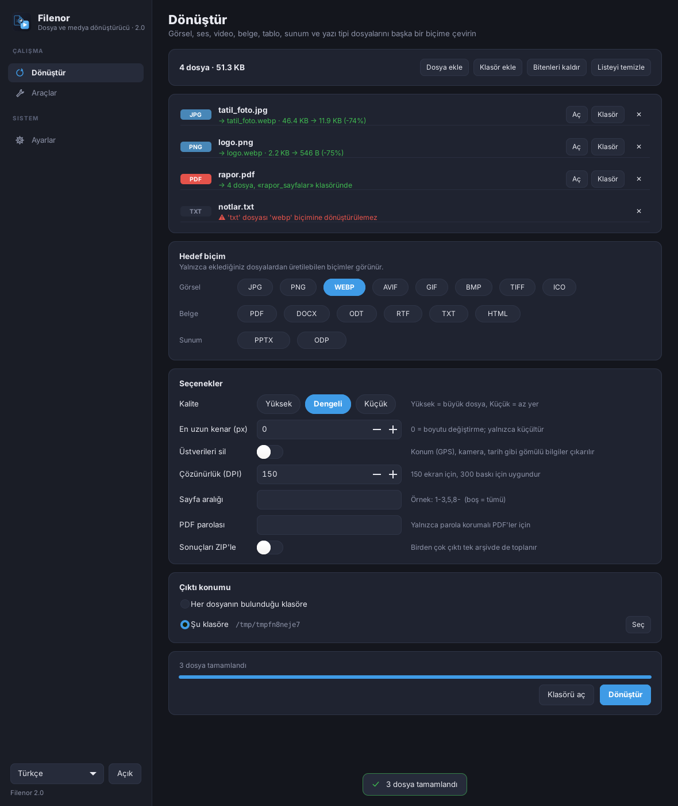
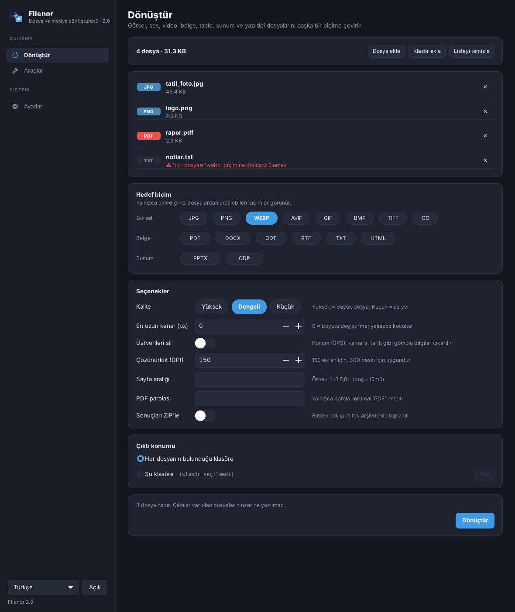
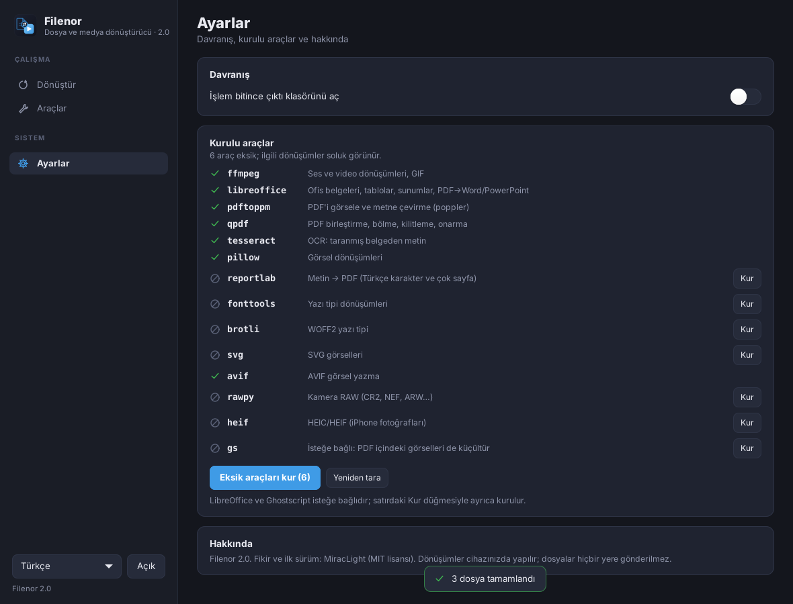

# Filenor

Türkçe · [English](README.md)


**Gizliliğe önem veren dosya ve medya dönüştürücü.** Her şey kendi bilgisayarınızda çalışır. Hiçbir şey yüklenmez, hesap gerekmez, dönüştürmek için internet gerekmez.



## Özellikler

- **Dönüştürme:** görseller (JPG, PNG, WEBP, AVIF, GIF, BMP, TIFF, ICO, HEIC, kamera RAW, SVG), ses, video, GIF, PDF ↔ görsel/metin, ofis belgeleri, tablolar ve sunumlar (LibreOffice ile), yazı tipleri (TTF/OTF/WOFF/WOFF2).
- **PDF ve görsel araçları:** birleştir, böl, sayfa seç, döndür, küçült, kilitle/kilidi aç, OCR, görselleri küçült ve üstverileri temizle, ses/video kırp.
- **Güvenli tasarım:** her dönüşüm gizli bir çalışma klasöründe yapılır ve var olan dosyanın üzerine yazmaz (`ad (1).uzantı`). Dış programlar kendi süreç grubunda çalışır; iptalde ya da zaman aşımında durdurulur.
- **Toplu kuyruk:** sürükle-bırak, dosya başına ilerleme, iptal.
- **Tek tıkla araç kurulumu:** eksik yardımcılar (ffmpeg, LibreOffice, poppler, qpdf, Tesseract …) *Ayarlar → Kur* ile kurulur — Debian/Ubuntu'da `apt`, Windows'ta `winget` ile. Aracı eksik biçimler hata vermek yerine soluk görünür.
- **Komut satırı:** `filenor-cli` aynı motoru kullanır.
- Koyu ve açık tema, Türkçe ve İngilizce.

<p>


</p>

## Kurulum

[Sürümler](https://github.com/MiracLight/filenor/releases) sayfasından indirin.

### Debian / Ubuntu

```bash
sudo apt install ./filenor_*_all.deb
filenor
```

Debian 12+ ya da Ubuntu 24.04+ gerekir (Python 3.11+, GTK 3). Bağımlılıkları `apt` getirir.

### Windows

`Filenor-<sürüm>-setup.exe` dosyasını çalıştırın (kullanıcıya özel, yönetici yetkisi gerekmez) ya da `Filenor-<sürüm>-windows-x64.zip` dosyasını açıp `Filenor.exe`'yi başlatın.

ffmpeg ve LibreOffice gibi yardımcı programlar pakete **dahil değildir** (lisansları Filenor'dan farklıdır). *Ayarlar*'ı açıp **Eksik araçları kur**'a basın; Filenor bunları `winget` ile kurar (Windows 10 1809+ / 11).

### Kaynaktan

```bash
sudo apt install python3-gi gir1.2-gtk-3.0 python3-pil     # Debian/Ubuntu
python3 filenor/filenor_uygulama.py
```

## Komut satırı

```text
filenor-cli durum                       kurulu araçlar
filenor-cli kur [ARAÇ...]               eksik araçları kur (--deneme: yalnız planı göster)
filenor-cli formatlar [uzantı]          hangi biçimden hangisine
filenor-cli donustur -t HEDEF DOSYA...  dönüştür, örn.  filenor-cli donustur -t webp foto.jpg
filenor-cli arac ARAÇ DOSYA...          araç çalıştır, örn.  filenor-cli arac pdf_birlestir a.pdf b.pdf
```

Çıkış kodları: `0` hepsi tamam, `1` en az biri hatalı, `2` kullanım, `130` iptal. PDF parolası için `FILENOR_PAROLA` ortam değişkenini kullanın (argümanlar `ps` ile görünür).

## Derleme

```bash
packaging/debian/build-deb.sh 2.0.0 dist     # .deb
```

Windows paketleri GitHub Actions ile üretilir (MSYS2 + PyInstaller + Inno Setup); bkz. `.github/workflows/build.yml` ve `packaging/windows/`.

Testler: `python3 -m unittest discover -s tests` (arayüz testleri GTK ve ekran ister, örn. `xvfb-run`).

## Geçmiş

1. sürüm, Windows için tek dosyalık bir customtkinter betiğiydi; `legacy/Filenor_v1.py` olarak saklanıyor. 2. sürüm, Linux ve Windows için ortak motorlu GTK 3 yeniden yazımıdır. Bkz. [CHANGELOG.md](CHANGELOG.md).

## Lisans

MIT — bkz. [LICENSE](LICENSE).
